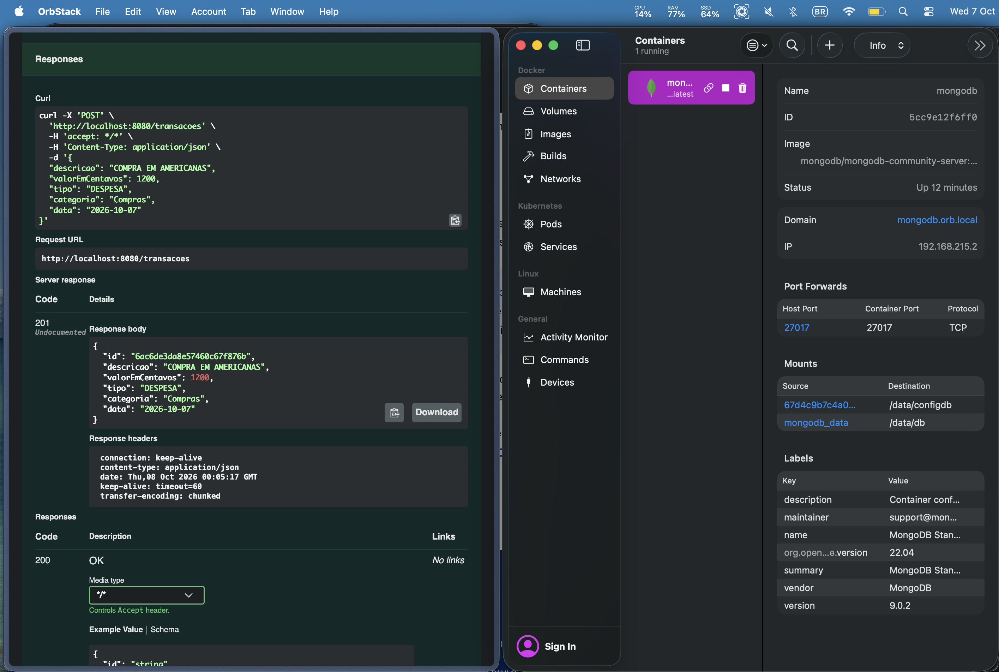
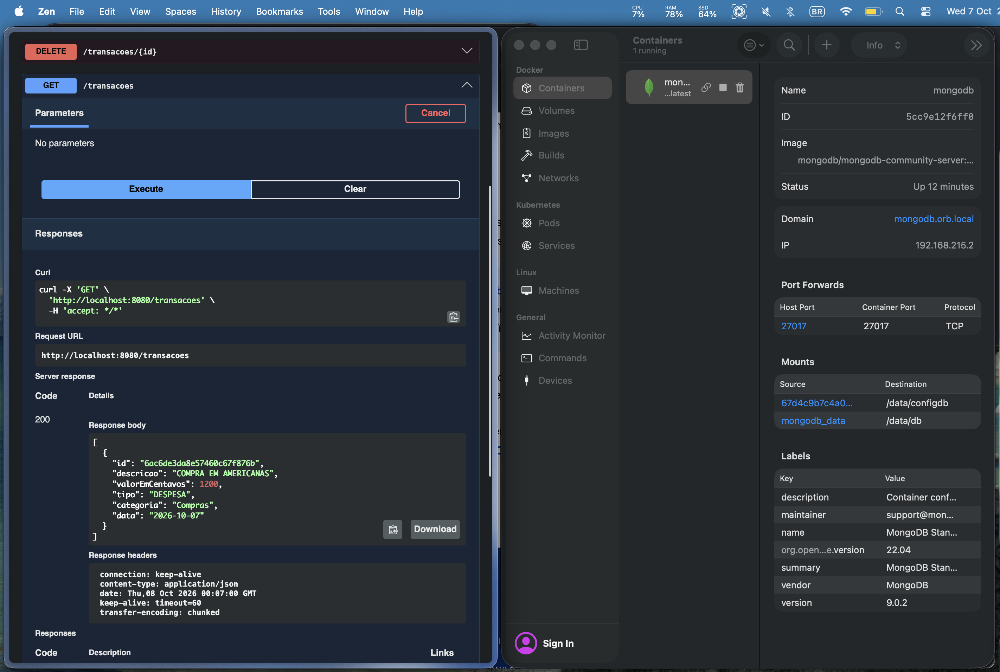

# Transações — ODM com API REST

Aluno: João Victor Lemes Faria — 202302614

Implementação ODM de uma entidade `Transacao` com Spring Data MongoDB, exposta por uma API REST com CRUD completo. 

## Entidade `Transacao`

- `id` (`String`): `@Id`, ObjectId gerado pelo MongoDB
- `descricao` (`String`): descrição do lançamento
- `valorEmCentavos` (`int`): valor em centavos (evita erro de ponto flutuante)
- `tipo` (`TipoTransacao`): `RECEITA` ou `DESPESA`
- `categoria` (`String`): ex.: `alimentacao`, `salario`
- `data` (`LocalDate`): data no formato `AAAA-MM-DD`

## Endpoints

- `POST /transacoes`
- `GET /transacoes`
- `GET /transacoes/{id}`
- `PUT /transacoes/{id}`
- `DELETE /transacoes/{id}`

### `src/main/resources/application.properties`

```properties
spring.data.mongodb.host=localhost
spring.data.mongodb.port=27017
spring.data.mongodb.database=meu_banco
```

### `src/main/java/odm/rest/App.java`

```java
package odm.rest;

import org.springframework.boot.SpringApplication;
import org.springframework.boot.autoconfigure.SpringBootApplication;

@SpringBootApplication
public class App {

    public static void main(String[] args) {
        SpringApplication.run(App.class, args);
    }
}
```

### `src/main/java/odm/rest/model/TipoTransacao.java`

```java
package odm.rest.model;

public enum TipoTransacao {
    RECEITA,
    DESPESA
}
```

### `src/main/java/odm/rest/model/Transacao.java`

```java
package odm.rest.model;

import java.time.LocalDate;

import org.springframework.data.annotation.Id;
import org.springframework.data.mongodb.core.mapping.Document;

@Document(collection = "transacao")
public class Transacao {

    @Id
    private String id;
    private String descricao;
    private int valorEmCentavos;
    private TipoTransacao tipo;
    private String categoria;
    private LocalDate data;

    public String getId() {
        return id;
    }

    public void setId(String id) {
        this.id = id;
    }

    public String getDescricao() {
        return descricao;
    }

    public void setDescricao(String descricao) {
        this.descricao = descricao;
    }

    public int getValorEmCentavos() {
        return valorEmCentavos;
    }

    public void setValorEmCentavos(int valorEmCentavos) {
        this.valorEmCentavos = valorEmCentavos;
    }

    public TipoTransacao getTipo() {
        return tipo;
    }

    public void setTipo(TipoTransacao tipo) {
        this.tipo = tipo;
    }

    public String getCategoria() {
        return categoria;
    }

    public void setCategoria(String categoria) {
        this.categoria = categoria;
    }

    public LocalDate getData() {
        return data;
    }

    public void setData(LocalDate data) {
        this.data = data;
    }
}
```

### `src/main/java/odm/rest/repository/TransacaoRepository.java`

```java
package odm.rest.repository;

import org.springframework.data.mongodb.repository.MongoRepository;

import odm.rest.model.Transacao;

public interface TransacaoRepository extends MongoRepository<Transacao, String> {
}
```

### `src/main/java/odm/rest/controller/TransacaoController.java`

```java
package odm.rest.controller;

import java.util.List;

import org.springframework.http.HttpStatus;
import org.springframework.http.ResponseEntity;
import org.springframework.web.bind.annotation.DeleteMapping;
import org.springframework.web.bind.annotation.GetMapping;
import org.springframework.web.bind.annotation.PathVariable;
import org.springframework.web.bind.annotation.PostMapping;
import org.springframework.web.bind.annotation.PutMapping;
import org.springframework.web.bind.annotation.RequestBody;
import org.springframework.web.bind.annotation.RequestMapping;
import org.springframework.web.bind.annotation.RestController;

import odm.rest.model.Transacao;
import odm.rest.repository.TransacaoRepository;

@RestController
@RequestMapping("/transacoes")
public class TransacaoController {

    private final TransacaoRepository repository;

    public TransacaoController(TransacaoRepository repository) {
        this.repository = repository;
    }

    @GetMapping
    public List<Transacao> listar() {
        return repository.findAll();
    }

    @GetMapping("/{id}")
    public ResponseEntity<Transacao> buscar(@PathVariable String id) {
        return ResponseEntity.of(repository.findById(id));
    }

    @PostMapping
    public ResponseEntity<Transacao> criar(@RequestBody Transacao transacao) {
        transacao.setId(null);
        return ResponseEntity.status(HttpStatus.CREATED).body(repository.save(transacao));
    }

    @PutMapping("/{id}")
    public ResponseEntity<Transacao> atualizar(@PathVariable String id, @RequestBody Transacao transacao) {
        if (!repository.existsById(id)) {
            return ResponseEntity.notFound().build();
        }
        transacao.setId(id);
        return ResponseEntity.ok(repository.save(transacao));
    }

    @DeleteMapping("/{id}")
    public ResponseEntity<Void> remover(@PathVariable String id) {
        if (!repository.existsById(id)) {
            return ResponseEntity.notFound().build();
        }
        repository.deleteById(id);
        return ResponseEntity.noContent().build();
    }
}
```

## Exemplos

```bash
# Criar
curl -X POST localhost:8080/transacoes -H 'Content-Type: application/json' \
  -d '{"descricao":"Mercado","valorEmCentavos":15990,"tipo":"DESPESA","categoria":"alimentacao","data":"2026-10-07"}'

# Listar
curl localhost:8080/transacoes

# Buscar por id
curl localhost:8080/transacoes/{id}

# Atualizar
curl -X PUT localhost:8080/transacoes/{id} -H 'Content-Type: application/json' \
  -d '{"descricao":"Salario","valorEmCentavos":500000,"tipo":"RECEITA","categoria":"salario","data":"2026-10-05"}'

# Remover
curl -X DELETE localhost:8080/transacoes/{id}
```

## Resultados

### Criação de transação (`POST /transacoes`) pelo Swagger UI

Resposta `201` com o documento persistido e o `id` gerado pelo MongoDB, que roda no container `mongodb` (à direita).



### Listagem de transações (`GET /transacoes`) pelo Swagger UI

Resposta `200` com a transação criada anteriormente, lida do banco.



## Conclusão

Com o Spring Data MongoDB, a persistência se torna muito mais simples. O ODM converte o objeto Java em documento BSON e o controller expõe as operações CRUD sobre HTTP, retornando 404 quando o id não existe.
